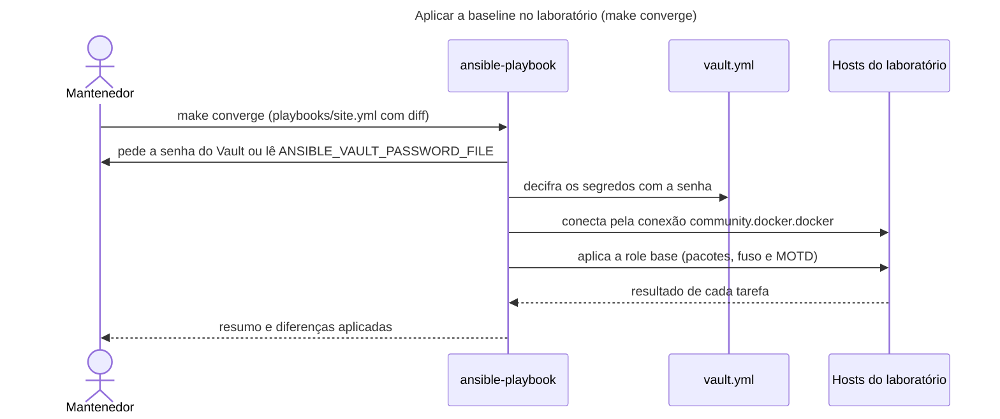
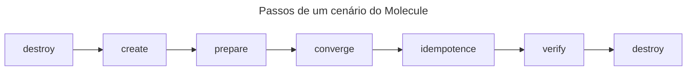

# Arquitetura: ansible-playbooks

> Estrutura baseada no arc42, de forma enxuta: as seções sem conteúdo real foram omitidas. Os diagramas seguem o modelo C4 e são gerados a partir de [`docs/diagramas/modelo.json`](../diagramas/modelo.json).

## 1. Introdução e objetivos
O `ansible-playbooks` é um repositório de playbooks e roles Ansible que o mantenedor usa para praticar automação de infraestrutura e para mostrar como estruturar, testar e proteger código Ansible. Hoje tem uma role (`base`: pacotes, fuso horário e MOTD), um laboratório de contêineres para aplicá-la, testes automáticos e uma CI. Não há servidor em produção nem host real: tudo roda em contêineres locais.

Os três principais objetivos de qualidade, em ordem de prioridade:
1. **Idempotência provada por teste:** aplicar uma role de novo não muda nada.
2. **Segredos protegidos:** nenhum valor sensível em texto puro no repositório.
3. **Reprodutibilidade:** o mesmo commit produz o mesmo resultado na máquina do mantenedor e na CI (versões fixadas).

Partes interessadas:

| Quem | O que espera |
| --- | --- |
| Mantenedor | Um lugar seguro para praticar, com padrões escritos e verificados |
| Colaborador novo | Entender e operar o repositório sem perguntar |
| Visitante do portfólio | Ver, no código, como o mantenedor estrutura, testa e protege Ansible |

## 2. Restrições
- O repositório é público: não guarda host real, IP nem credencial (`docs/standards.md`, seção "Variables and inventories").
- O alvo padrão é sempre o laboratório local (`ansible.cfg`, linhas 2 e 3). Nenhum comando do repositório age sobre um host real.
- Funciona em macOS e Linux, com Docker, `uv`, `make`, pre-commit e gitleaks (`README.md`, "Quick start"). Python 3.14 (`pyproject.toml`, linha 7).
- A senha do Vault nunca entra no repositório.
- Contêineres não testam parâmetros de kernel, firewall, auditd nem o relógio do sistema (`docs/standards.md`, linha 82).

## 3. Contexto e escopo
O diagrama responde: quem interage com o repositório e de quais sistemas externos ele depende? O sistema fica no centro. O mantenedor o opera pela linha de comando e publica o código no GitHub. O GitHub hospeda o código e dispara a CI; o Docker Engine local executa os contêineres de teste e do laboratório; os registros públicos fornecem ferramentas, coleções e imagens. O visitante do portfólio, que só lê o código e a documentação no GitHub, não está no desenho para mantê-lo legível.

| Sistema externo | O que troca com o sistema | Protocolo |
| --- | --- | --- |
| GitHub | Recebe commits e pull requests; dispara o workflow de CI; o Dependabot abre pull requests semanais de atualização das actions; o visitante lê o código e a documentação | Git, HTTPS, GitHub Actions |
| Docker Engine local | Executa os contêineres do laboratório e dos cenários do Molecule | API do Docker |
| Registros públicos (PyPI, Ansible Galaxy, Docker Hub) | Fornecem as ferramentas Python (`uv.lock`), as coleções (`requirements.yml`) e as imagens base e de ferramenta | HTTPS |

## 4. Estratégia da solução
Estas decisões moldam o resto. Cada uma tem um ADR.

| Decisão | ADR |
| --- | --- |
| Tudo o que o repositório usa tem versão fixada, e as atualizações passam por revisão | [ADR-0002](../decisoes/0002-versoes-fixadas.md) |
| Segredos em duas partes: referência em texto puro e valor cifrado no Vault | [ADR-0003](../decisoes/0003-vault-em-duas-partes.md) |
| Laboratório de contêineres com systemd, sem SSH nem IP | [ADR-0004](../decisoes/0004-laboratorio-conteineres-systemd.md) |
| Roles testadas em Ubuntu 24.04 e 26.04, com segunda execução sem mudanças | [ADR-0007](../decisoes/0007-molecule-ubuntu-2404-2604-idempotencia.md) |
| Hooks do pre-commit só locais | [ADR-0005](../decisoes/0005-hooks-pre-commit-locais.md) |
| Imagem oficial do Trivy em vez do `trivy-action` | [ADR-0001](../decisoes/0001-imagem-oficial-do-trivy.md) |
| Um único check na CI, o `CI result`, feito para o ruleset exigir (hoje não exige; ver seção 11) | [ADR-0006](../decisoes/0006-check-obrigatorio-ci-result.md) |

## 5. Visão de blocos
O diagrama responde: o que roda, onde ficam os segredos e como as peças se ligam? Os "contêineres" do C4 são o que precisa estar em execução ou guardado para o sistema funcionar; não têm relação com Docker. Papéis, playbooks e inventários são organização de código e, por isso, não aparecem como caixas: o Controlador Ansible os executa. O pipeline de CI aparece como contêiner porque o time o configura, embora rode no GitHub. Para o desenho ficar legível, ele omite algumas ligações, que estão descritas aqui:
- O Mantenedor aciona o Controlador Ansible, os Testes Molecule, as Verificações de qualidade e o Laboratório com `make` (`make converge`, `make test`, `make lint`, `make lab-up`).
- O Pipeline de CI roda os mesmos `make lint` e `make test`, ou seja, as caixas "Verificações de qualidade" e "Testes Molecule", e baixa ferramentas e imagens dos registros públicos.
- O Laboratório, como os Testes Molecule, executa seus contêineres no Docker Engine local.

| Contêiner | Responsabilidade | Tecnologia | Onde está no código |
| --- | --- | --- | --- |
| Controlador Ansible | Aplica playbooks e roles nos hosts do laboratório | ansible-core 2.21.6, `make converge` e `make check` | `playbooks/`, `roles/base/`, `inventories/lab/`, `ansible.cfg` |
| Testes Molecule | Testa a role `base` em Ubuntu 24.04 e 26.04, com idempotência e verificação do estado final | Molecule 26.11.0, driver Docker | `molecule/base/`, `tests/images/ubuntu/Dockerfile` |
| Verificações de qualidade | Confere o estilo, a conformidade, os segredos e a cifragem do Vault, nos hooks e no `make lint` | pre-commit, yamllint, ansible-lint, gitleaks, `scripts/check-vault-encrypted.sh` | `.pre-commit-config.yaml`, `.yamllint.yml`, `.ansible-lint.yml`, `scripts/` |
| Pipeline de CI | Roda `make lint`, `make test` e a varredura de segurança (hadolint, Trivy, zizmor) a cada pull request e push; baixa as ferramentas e as imagens dos registros | GitHub Actions | `.github/workflows/ci.yml`, `trivy.yaml`, `.trivyignore` |
| Laboratório | Três hosts Ubuntu com systemd (`web-01`, `web-02`, `db-01`) onde os playbooks são aplicados | Docker Compose | `lab/compose.yml`, `inventories/lab/hosts.yml` |
| Cofre do laboratório | Guarda o segredo de demonstração, cifrado | Arquivo `vault.yml`, Ansible Vault (AES256) | `inventories/lab/group_vars/all/vault.yml` |

A organização do código dentro do Controlador Ansible está descrita em `docs/standards.md`, seção "Layout" (inglês).

## 6. Visão de execução
Dois fluxos valem um diagrama: aplicar a baseline no laboratório e rodar um cenário do Molecule.

**Aplicar a baseline no laboratório.** O diagrama responde: o que acontece entre o `make converge` e a mudança nos hosts? Observe onde a senha do Vault entra e que a conexão é feita pelo Docker, não por SSH.

**Cenário do Molecule.** O diagrama responde: em que ordem o Molecule prepara, aplica, repete e confere? Observe que `converge` roda duas vezes: a segunda é o passo `idempotence`.

Esses passos vêm de `molecule/base/` e foram conferidos com `molecule matrix`. O `prepare.yml` deixa o host como uma imagem recém-construída em um runner Linux (listas do `apt` vazias com data recente), para que a execução local e a CI percorram o mesmo caminho.

## 7. Visão de implantação
Não há ambiente implantado. O repositório não publica nada: os ambientes abaixo existem só para praticar e testar. Por isso não há diagrama de implantação.

| Ambiente | Propósito | Como é implantado |
| --- | --- | --- |
| Laboratório local | Aplicar os playbooks e ver o resultado | `make lab-up` cria os contêineres; `make lab-down` os remove |
| Hosts do Molecule | Testar uma role em Ubuntu 24.04 e 26.04 | Criados e removidos pelo próprio cenário, a cada `make test` |
| Runner da CI | Rodar lint, testes e varredura de segurança | `ubuntu-24.04`, hospedado pelo GitHub, a cada pull request e push |

## 8. Conceitos transversais
- **Segredos.** Vault em duas partes ([ADR-0003](../decisoes/0003-vault-em-duas-partes.md)): referência em `main.yml`, valor cifrado em `vault.yml`. A senha fica fora do repositório. O hook `vault-encrypted` e o `make lint` barram arquivo do Vault em texto puro; o `.gitignore` bloqueia padrões de arquivos de senha, chaves e `.env`; o gitleaks (só local) procura segredos nas mudanças preparadas para commit. Tarefas que manipulam segredos usam `no_log: true` (`docs/standards.md`).
- **Versões fixadas.** Python e ferramentas no `uv.lock`, coleções no `requirements.yml`, actions por SHA, imagens por digest ([ADR-0002](../decisoes/0002-versoes-fixadas.md)).
- **Qualidade estática.** `yamllint --strict` e `ansible-lint` no perfil `production`, nos hooks e no `make lint`.
- **Idempotência e validação de entrada.** Cada role declara suas entradas em `meta/argument_specs.yml` e valida o que pode quebrar um host antes de qualquer mudança (por exemplo, a role `base` falha antes de alterar nada se o fuso não existir, `roles/base/tasks/configure.yml`, linhas 7 a 12).
- **Privilégios.** O `become` é declarado por play ou por tarefa, nunca no `ansible.cfg`; a verificação de chave de host fica ligada.
- **Observabilidade.** Não há: o repositório não tem serviço em execução. O que existe é a saída com diferenças (`--diff`) dos comandos e o log da CI.

## 9. Decisões de arquitetura
| ADR | Título | Status |
| --- | --- | --- |
| [0001](../decisoes/0001-imagem-oficial-do-trivy.md) | Usar a imagem oficial do Trivy em vez do `trivy-action` | aceito |
| [0002](../decisoes/0002-versoes-fixadas.md) | Fixar todas as versões que o repositório usa | aceito |
| [0003](../decisoes/0003-vault-em-duas-partes.md) | Guardar segredos no Ansible Vault em duas partes | aceito |
| [0004](../decisoes/0004-laboratorio-conteineres-systemd.md) | Usar um laboratório de contêineres com systemd, acessado pela conexão `community.docker` | aceito |
| [0005](../decisoes/0005-hooks-pre-commit-locais.md) | Usar só hooks locais no pre-commit | aceito |
| [0006](../decisoes/0006-check-obrigatorio-ci-result.md) | Exigir um único check, o `CI result` | aceito |
| [0007](../decisoes/0007-molecule-ubuntu-2404-2604-idempotencia.md) | Testar as roles no Ubuntu 24.04 e no 26.04, com a segunda execução sem mudanças | aceito |

Há outras decisões visíveis no código que ainda não têm ADR: o passo `dependency` do Molecule desabilitado, com as coleções do driver fixadas no `requirements.yml` (`molecule/base/molecule.yml`, linhas 14 a 20); o fuso aplicado por link e não por `timedatectl` (`roles/base/tasks/configure.yml`, linhas 14 e 15); o `ansible-lint` no perfil `production` (`.ansible-lint.yml`). Vale registrá-las, com as alternativas, quando o mantenedor as explicar.

## 10. Requisitos de qualidade
Cada cenário diz quem estimula o quê, em que ambiente, e como se mede a resposta. A última coluna diz como a verificação é automática.

| Cenário | Estímulo e ambiente | Resposta e medida | Verificação automática |
| --- | --- | --- | --- |
| Idempotência | Aplicar a role `base` pela segunda vez em Ubuntu 24.04 e 26.04 | Nenhuma tarefa reporta mudança (0 `changed`) | Passo `idempotence` do Molecule, no job `Molecule` (`make test`) |
| Segredo protegido | Um `vault.yml` em texto puro entra no commit ou no lint | O comando falha com código de saída 1 e aponta o arquivo | `scripts/check-vault-encrypted.sh`, no hook e no job `Lint` (`make lint`) |
| Compatibilidade | Aplicar a role em Ubuntu 24.04 e 26.04 | Os passos `converge` e `verify` passam nas duas plataformas | Job `Molecule` |
| Qualidade do código | Qualquer pull request | Zero violações de `yamllint --strict` e `ansible-lint` (perfil `production`) | Job `Lint` |
| Segurança da CI | Qualquer pull request | Zero achados do hadolint, do Trivy e do zizmor | Job `Security` |
| Reprodutibilidade | Instalar o toolchain em outra máquina | As ferramentas instaladas são as do `uv.lock` e as coleções são as do `requirements.yml` | `make setup` (`uv sync --frozen`), igual na CI; sem verificação dedicada de que o `uv.lock` está em dia |
| Entrada inválida | Informar um fuso que não existe | A role falha antes de qualquer mudança | Sem teste automático (ver riscos) |

## 11. Riscos e débitos técnicos
Impacto e probabilidade são estimativas de quem escreveu este documento, não medições.

| Risco ou débito | Impacto | Probabilidade | O que fazer |
| --- | --- | --- | --- |
| O `.trivyignore` (DS-0002 e DS-0026) vale para o repositório inteiro, apesar do comentário "only" ([ADR-0001](../decisoes/0001-imagem-oficial-do-trivy.md)) | Médio: um Dockerfile novo que rode como root passa pelo Trivy | Baixa | Manter a regra "outro Dockerfile roda sem root" na revisão do pull request |
| O gitleaks roda só localmente: nem a CI nem o `make lint` o executam ([ADR-0005](../decisoes/0005-hooks-pre-commit-locais.md)) | Médio: quem não instalou os hooks não tem varredura de segredos | Média | Adicionar o gitleaks à CI (melhoria futura) |
| O `needs` do `ci-result` é manual ([ADR-0006](../decisoes/0006-check-obrigatorio-ci-result.md)) | Médio: um job novo fora da lista não derruba o `CI result` | Baixa | Revisar o `needs` em todo pull request que mexe nos jobs |
| O zizmor roda com `uvx` e só a versão dele é fixa: as dependências transitivas ficam fora do `uv.lock` | Baixo | Baixa | Aceitar, ou fixar de outro modo se o risco crescer |
| O Dependabot cobre só as actions; imagens, uv, zizmor, dependências Python e coleções são manuais ([ADR-0002](../decisoes/0002-versoes-fixadas.md)) | Médio: versões ficam velhas | Média | Revisão mensal ([runbook](../runbooks/atualizar-versoes-fixadas.md)) |
| O Vault do laboratório não funciona para quem clona, porque a senha não está no repositório | Baixo: o laboratório só tem valores falsos | Alta | Pedir a senha ao responsável por um canal seguro ([runbook do Vault](../runbooks/vault.md)) |
| O `verify.yml` não confere o pacote `htop`, que está nos padrões da role (`molecule/base/verify.yml`, linha 17) | Baixo | Média | Incluir os pacotes padrão completos na verificação |
| O erro por fuso inexistente (`roles/base/tasks/configure.yml`, linhas 7 a 12) não tem teste automático | Baixo | Baixa | Acrescentar um cenário de falha esperada |
| O laboratório e o Molecule usam `privileged: true` e o cgroup do host ([ADR-0004](../decisoes/0004-laboratorio-conteineres-systemd.md)) | Médio se usados fora da máquina local | Baixa | Usar só localmente; nunca implantar a imagem de teste |
| O `docs/portal.html` é derivado e pode ficar desatualizado se um Markdown mudar sem o portal ser gerado de novo | Baixo | Média | Regerar o portal a cada mudança na documentação; não há verificação automática |
| O ruleset `protege-main-develop` não exige o `CI result`: uma CI vermelha não bloqueia o merge. Verificado em 10/11/2026 na configuração de rulesets do repositório no GitHub, que não está no código ([ADR-0006](../decisoes/0006-check-obrigatorio-ci-result.md)) | Médio: uma mudança com lint, teste ou varredura de segurança falhando pode entrar em `main` ou `develop` | Presente hoje (o ruleset tem `deletion`, `non_fast_forward`, `required_signatures` e `pull_request` com 0 aprovações, sem `required_status_checks`; a `main` não tem proteção clássica) | Mitigação possível: adicionar `required_status_checks` com o `CI result` ao ruleset, uma ação no GitHub fora deste repositório. Até lá, quem revisa confere o `CI result` antes de mesclar |

## 12. Glossário
| Termo | Significado |
| --- | --- |
| ADR | Registro de decisão de arquitetura (Architecture Decision Record): um arquivo por decisão, com contexto, alternativas e consequências |
| Converge | Passo em que o Ansible aplica uma role ou um playbook a um host |
| Digest | Identificador imutável de uma imagem de contêiner (`sha256:...`); ao contrário da tag, não muda |
| Idempotência | Propriedade de uma automação que, aplicada de novo, não muda nada |
| Laboratório | Os três contêineres Ubuntu com systemd, em `lab/compose.yml`, onde os playbooks são aplicados |
| Molecule | Ferramenta que testa roles Ansible em hosts descartáveis |
| Role | Unidade reutilizável de automação Ansible (`roles/base/`) |
| Ruleset | Regra de proteção de branch no GitHub, que pode exigir checks antes do merge |
| SHA fixo | Referência a um commit completo de uma action, em vez de uma tag que pode ser movida |
| systemd | Gerenciador de serviços do Linux; nos hosts de teste ele roda como PID 1 |
| Vault | Recurso do Ansible que cifra arquivos com senha (`ansible-vault`) |

## Pendências
Nenhuma pendência aberta. O risco do ruleset está na seção 11.

## Referências
- [Pipeline de CI](../pipelines/ci.md); [runbooks](../runbooks/); [decisões](../decisoes/); [padrões do repositório](../standards.md) (inglês).
- Modelo C4: <https://c4model.com/> (conferido em 10/11/2026), com o checklist de revisão de diagramas em <https://c4model.com/diagrams/checklist>.
- arc42: estrutura usada de forma enxuta.
