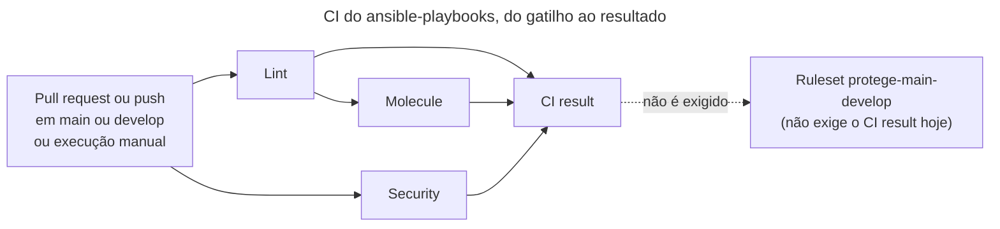

# Pipeline: CI do ansible-playbooks

## Resumo
A CI valida cada mudança antes de ela entrar em `main` ou `develop`: confere o estilo e os segredos (Lint), prova que as roles funcionam e são idempotentes em Ubuntu 24.04 e 26.04 (Molecule) e procura problemas de segurança no Dockerfile, nos arquivos de configuração e nos workflows (Security). Um job final, o `CI result`, reúne o resultado dos três e é o check feito para o ruleset da branch exigir. **Hoje o ruleset não o exige**: uma CI vermelha não impede o merge (ver [Pendências e risco conhecido](#pendências-e-risco-conhecido)).

Roda em pull requests e em pushes para `main` e `develop`, e também sob demanda. **Não há deploy**: o repositório não publica nada nem altera um host real. O único alvo dos playbooks é o laboratório local de contêineres. O principal risco é uma ferramenta ou uma action da CI ser comprometida, e é por isso que tudo o que a CI executa tem versão fixada (ver [ADR-0002](../decisoes/0002-versoes-fixadas.md)).

Definição: [`.github/workflows/ci.yml`](../../.github/workflows/ci.yml).

## Do commit ao resultado
O diagrama mostra os gatilhos e os quatro jobs. Observe que o `Security` roda em paralelo com o `Lint` e que o `Molecule` só começa depois do `Lint`. O `CI result` espera os três.

## Etapas
Todos os jobs rodam em `ubuntu-24.04`. "Falha bloqueia?" quer dizer: derruba o `CI result`. Isso não impede o merge hoje, porque o ruleset não exige o check `CI result` (verificado em 10/11/2026 na configuração de rulesets do repositório no GitHub, que não está no código).

| Job | Etapa | O que faz | Onde está definido | Falha bloqueia? |
| --- | --- | --- | --- | --- |
| `Lint` (10 min) | Check out | Baixa o código, sem guardar credenciais | `ci.yml`, linhas 32 a 35 | Sim |
| `Lint` | actionlint | Confere a sintaxe dos workflows (imagem fixada por digest) | `ci.yml`, linhas 37 a 40 | Sim |
| `Lint` | Set up uv e cache das coleções | Instala o uv na versão fixada; guarda o cache do uv e das coleções Ansible (chave: hash do `requirements.yml`) | `ci.yml`, linhas 42 a 53 | Sim |
| `Lint` | `make setup` | Cria o ambiente Python do `uv.lock` e instala as coleções do `requirements.yml` | `ci.yml`, linhas 55 e 56; `Makefile`, linhas 21 a 23 | Sim |
| `Lint` | `make lint` | Roda `yamllint --strict`, `ansible-lint` (perfil `production`) e `scripts/check-vault-encrypted.sh` | `ci.yml`, linhas 58 e 59; `Makefile`, linhas 28 a 31 | Sim |
| `Molecule` (30 min) | `make setup` | Igual ao do `Lint` | `ci.yml`, linhas 61 a 86 | Sim |
| `Molecule` | `make test` | Constrói as imagens Ubuntu 24.04 e 26.04 e roda todos os cenários do Molecule, com a checagem de idempotência | `ci.yml`, linhas 88 e 89; `Makefile`, linhas 33 a 38 | Sim |
| `Security` (10 min) | hadolint | Confere o `tests/images/ubuntu/Dockerfile` | `ci.yml`, linhas 101 a 105 | Sim |
| `Security` | Trivy config | Varre os arquivos de configuração do repositório (`config --exit-code 1 .`); qualquer achado reprova | `ci.yml`, linhas 107 a 110; `trivy.yaml`; `.trivyignore` | Sim |
| `Security` | zizmor | Audita os workflows (`uvx zizmor@1.32.0 --offline .`) | `ci.yml`, linhas 112 a 121 | Sim |
| `CI result` (5 min) | Check the result of every job | Falha se algum dos três jobs terminou com resultado diferente de `success` | `ci.yml`, linhas 123 a 142 | Sim, é o check feito para o ruleset exigir (hoje não exige) |

## Gatilhos e aprovações
- **Eventos:** `pull_request` com destino `main` ou `develop`; `push` em `main` ou `develop`; `workflow_dispatch` (execução manual). Fonte: `ci.yml`, linhas 4 a 9.
- **Cancelamento:** um novo push em um pull request cancela a execução anterior; pushes em `main` e `develop` sempre terminam (`ci.yml`, linhas 14 a 16). Por isso uma execução cancelada reprova o `CI result` daquela execução: vale a mais recente.
- **Aprovações:** não há aprovação manual nem ambiente protegido na CI, porque não há deploy. A aprovação é a revisão do pull request, e quem revisa deve conferir o `CI result` antes de mesclar: o ruleset não exige esse check hoje (verificado em 10/11/2026 no GitHub).
- **Atualizações:** o Dependabot abre, toda semana, um pull request agrupado com as novas versões das actions para a branch `develop`, com o prefixo `ci` (`.github/dependabot.yml`).

## Credenciais e permissões
- O workflow declara `permissions: contents: read` (`ci.yml`, linhas 11 e 12): o `GITHUB_TOKEN` só lê o repositório.
- O check out usa `persist-credentials: false`: o token não fica gravado no diretório de trabalho.
- A CI não usa nenhum segredo nem acessa nuvem. O `Lint` confere se o `vault.yml` está cifrado e o Molecule não usa o Vault, então não há senha do Vault na CI.

## Por que é assim
Estas são as razões das escolhas do workflow. Parte delas estava em comentários do `ci.yml` e do `trivy.yaml`, removidos no commit `d5b908e`; ficam aqui para não se perderem.

- **A CI roda os mesmos comandos do dia a dia.** Os jobs chamam `make lint` e `make test`, os mesmos alvos que o mantenedor roda na máquina, e acrescentam a varredura de segurança.
- **Sem segredos.** O lint só confere se o `vault.yml` está cifrado e o Molecule não usa o Vault. Por isso o workflow não precisa de nenhum segredo, e `contents: read` basta.
- **Tudo fixado.** As actions vão por SHA (o Dependabot as atualiza). As imagens de ferramenta (actionlint, hadolint e Trivy) vão por digest. As versões do uv e do zizmor ficam no próprio workflow. Essas três últimas categorias são atualizadas à mão, como o resto do toolchain. A política completa está no [ADR-0002](../decisoes/0002-versoes-fixadas.md) e o procedimento, no [runbook de atualização](../runbooks/atualizar-versoes-fixadas.md).
- **Cancelamento só em pull request.** Um novo push em um pull request cancela a execução anterior (`cancel-in-progress` só vale quando o evento é `pull_request`). Pushes em `main` e `develop` sempre terminam.
- **O passo do Molecule constrói as imagens.** O `make test` depende do alvo `image`, que constrói as imagens de teste Ubuntu 24.04 e 26.04 antes de rodar os cenários.
- **Imagem oficial do Trivy, não o `trivy-action`.** Por causa do aviso GHSA-69fq-xp46-6x23 (comprometimento do ecossistema do Trivy em março de 2026). O Trivy lê o `trivy.yaml` e o `.trivyignore` da raiz do repositório. Detalhes no [ADR-0001](../decisoes/0001-imagem-oficial-do-trivy.md).
- **O `trivy.yaml` ignora o que não é código deste repositório.** Pula `.venv`, `.ansible`, `.cache` e as pastas `ansible-hardening` e `ansible-scripts` (projetos antigos que ficam na mesma pasta de trabalho, fora do repositório; ver `.gitignore`).
- **O job `Security` não usa cache do uv.** O comentário no `ci.yml` (linhas 112 e 113) explica: esse job não sincroniza o `uv.lock` e salvaria um cache incompleto sob a mesma chave que o `Lint` e o `Molecule` usam.
- **Um check único para o ruleset.** O `CI result` existe para que o ruleset possa exigir um nome só; hoje o ruleset não o exige. Ver [ADR-0006](../decisoes/0006-check-obrigatorio-ci-result.md).

## Versões fixadas na CI
| O que | Versão | Onde |
| --- | --- | --- |
| Runner | `ubuntu-24.04` | `ci.yml`, linhas 29, 64, 93 e 125 |
| `actions/checkout` | v7.0.1, por SHA | linhas 33, 68 e 97 |
| `astral-sh/setup-uv` | v10.3.3, por SHA | linhas 43, 73 e 115 |
| `actions/cache` | v6.1.0, por SHA | linhas 50 e 80 |
| uv | 0.13.1 | linhas 45, 75 e 117 |
| actionlint | 1.7.12, por digest | linha 38 |
| hadolint | v2.15.1, por digest | linha 102 |
| Trivy | 0.76.2, por digest | linha 108 |
| zizmor | 1.32.0 | linha 121 |

## Como reverter
Não há deploy para desfazer. Para voltar a CI a um estado bom:
1. Se uma mudança no `ci.yml` quebrou a CI, reverta o commit que a introduziu (`git revert <commit>`) e abra um pull request com a reversão.
2. Se a falha veio de uma atualização de versão, reverta só a linha da versão (a anterior está no histórico do Git) e refaça a atualização depois.
3. Se a execução só falhou por um problema passageiro, use "Re-run failed jobs" na página da execução.

Para diagnosticar uma execução vermelha, siga o [runbook de falha na CI](../runbooks/falha-na-ci.md).

## Pendências e risco conhecido
- **Risco conhecido:** o ruleset `protege-main-develop` está ativo em `main` e `develop` e tem as regras `deletion`, `non_fast_forward`, `required_signatures` e `pull_request` (0 aprovações exigidas), mas não tem `required_status_checks`. Também não há proteção clássica na `main`. Portanto o ruleset não exige o `CI result`, e uma CI vermelha não impede o merge. Verificado em 10/11/2026 na configuração de rulesets do repositório no GitHub, que não está no código. Mitigação possível: adicionar `required_status_checks` com o `CI result` ao ruleset, uma ação no GitHub fora deste repositório. Até lá, quem revisa confere o `CI result` antes de mesclar.
- Melhoria futura conhecida: o `gitleaks` não roda na CI (ver [ADR-0005](../decisoes/0005-hooks-pre-commit-locais.md)).

## Referências
- [`.github/workflows/ci.yml`](../../.github/workflows/ci.yml), [`.github/dependabot.yml`](../../.github/dependabot.yml), [`trivy.yaml`](../../trivy.yaml), [`.trivyignore`](../../.trivyignore), [`Makefile`](../../Makefile).
- [Arquitetura](../arquitetura/arquitetura.md); ADRs [0001](../decisoes/0001-imagem-oficial-do-trivy.md), [0002](../decisoes/0002-versoes-fixadas.md) e [0006](../decisoes/0006-check-obrigatorio-ci-result.md).
