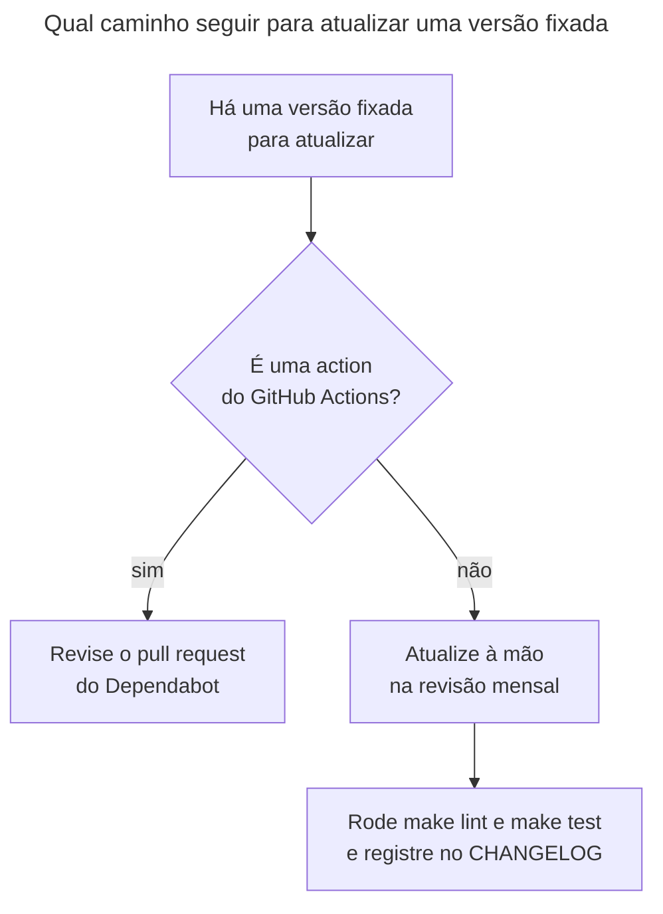

# Runbook: atualizar as versões fixadas

> [!NOTE]
> Quando usar: chegou o pull request semanal do Dependabot, ou é dia da revisão mensal das versões que o Dependabot não cobre (imagens por digest, `uv.lock`, coleções, `ansible-core`, uv e zizmor).

O repositório fixa toda versão que usa, para que a CI só mude por commit ([ADR-0002](../decisoes/0002-versoes-fixadas.md)). Fixar tem um custo: alguém precisa atualizar. As actions têm o Dependabot; o resto passa por uma **revisão mensal**, feita pelo responsável do repositório. Atualização é decisão consciente: nenhuma versão nova entra sem alguém olhar.

## Antes de começar
- Acessos necessários: permissão de escrita no repositório, Docker, `uv`, `make` e o ambiente de `make setup`.
- Impacto esperado: muda arquivos de versão e pode alterar o comportamento da CI e dos testes. Faça cada tipo de atualização em um pull request próprio, para reverter com facilidade.

## Diagnóstico
O fluxo mostra qual caminho seguir.



O que está fixado e quem atualiza:

| Item | Versão hoje | Onde está | Quem atualiza |
| --- | --- | --- | --- |
| Python | 3.14 | `.python-version`; `pyproject.toml`, linha 7 (`requires-python`) | Revisão mensal |
| `ansible-core`, `ansible-lint`, `molecule`, `molecule-plugins`, `yamllint` | 2.21.6, 26.10.1, 26.11.0, 26.11.0, 1.38.0 | `pyproject.toml`, linhas 9 a 13; `uv.lock` | Revisão mensal |
| Coleções `community.docker` e `ansible.posix` | 5.4.0 e 2.2.2 | `requirements.yml`, linhas 5 a 9 | Revisão mensal |
| Imagem base Ubuntu 24.04 | por digest | `tests/images/ubuntu/Dockerfile`, linha 7 | Revisão mensal |
| Imagem base Ubuntu 26.04 | por digest | `Makefile`, linha 10 | Revisão mensal |
| Imagens de ferramenta: actionlint, hadolint e Trivy | 1.7.12, v2.15.1 e 0.76.2, por digest | `ci.yml`, linhas 38, 102 e 108 | Revisão mensal |
| uv | 0.13.1 | `ci.yml`, linhas 45, 75 e 117 | Revisão mensal |
| zizmor | 1.32.0 | `ci.yml`, linha 121 | Revisão mensal |
| Actions (`checkout`, `setup-uv`, `cache`) | por SHA | `ci.yml` (várias linhas) | Dependabot, toda semana |
| Runner | `ubuntu-24.04` | `ci.yml` (quatro jobs) | Revisão mensal |

## Correção
**Actions (pull request do Dependabot).** O Dependabot abre, toda semana, um pull request agrupado para `develop`, com o prefixo `ci`. Ele espera 7 dias depois de uma versão sair antes de propô-la (`cooldown`), para que uma versão comprometida tenha tempo de ser descoberta.
1. Leia as notas de versão de cada action alterada.
2. Confira que o SHA do diff é o da versão que o comentário indica. Por exemplo, para a tag `v7.0.1` de uma action:
   ```bash
   git ls-remote https://github.com/actions/checkout refs/tags/v7.0.1
   ```
   O SHA impresso deve ser o do diff. Não altera nada.
3. Espere o `CI result` ficar verde e faça o merge.

**Revisão mensal: dependências Python e `ansible-core`.**
1. Edite a versão em `pyproject.toml`.
2. Atualize o `uv.lock` para o pacote alterado.
   ```bash
   uv lock --upgrade-package <pacote>
   ```
   Altera o `uv.lock`.
3. Instale e teste.
   ```bash
   make setup
   make lint
   make test
   ```
4. Se mudou o `ansible-core`, atualize também o selo do `README.md` (linha 4) e a menção no `CHANGELOG.md`.

**Revisão mensal: coleções.**
1. Edite a versão em `requirements.yml`.
2. Rode `make setup`, `make lint` e `make test`. Lembre que o `requirements.yml` é a única fonte das coleções do driver Docker do Molecule (`docs/standards.md`).

**Revisão mensal: imagens por digest.**
1. Descubra o digest atual do índice multiarquitetura da imagem (o `Dockerfile` pede o índice com `amd64` e `arm64`).
   ```bash
   docker buildx imagetools inspect ubuntu:24.04
   ```
   Procure a linha `Digest:` do índice (comando padrão do Docker, a conferir na primeira execução). Não altera nada.
2. Troque o digest no `Dockerfile` (24.04) ou no `Makefile` (26.04). Para as imagens de ferramenta, troque a tag e o digest em `ci.yml`.
3. Rode `make image`, `make lint` e `make test`.

**Revisão mensal: uv e zizmor.**
1. Troque a versão em `ci.yml`: o uv aparece em três jobs (`version: "0.13.1"`) e o zizmor, em uma linha (`uvx zizmor@1.32.0`).
2. Teste o zizmor na sua máquina com `uvx zizmor@<nova versão> --offline .` antes de abrir o pull request.

**Em todos os casos manuais:** registre a atualização no `CHANGELOG.md` (`docs/standards.md`: "change the version, run `make lint test`, then record it in the changelog") e abra o pull request.

## Verificação
- `make lint` e `make test` passam na sua máquina e o `CI result` fica verde no pull request.
- O comando `git diff` mostra só as linhas de versão que você pretendia mudar.
- Para as actions, o SHA de cada linha corresponde à tag do comentário.

## Se não resolver
Se um teste quebra depois da atualização, reverta a linha da versão e abra uma issue no repositório `FWesleycosta/ansible-playbooks` com o log da falha, a versão antiga e a nova, e avise o responsável do repositório. Para falhas da CI, siga o [runbook de falha na CI](falha-na-ci.md); para falhas do Molecule, o [runbook do Molecule](molecule.md).

## Pendências
Nenhuma.
