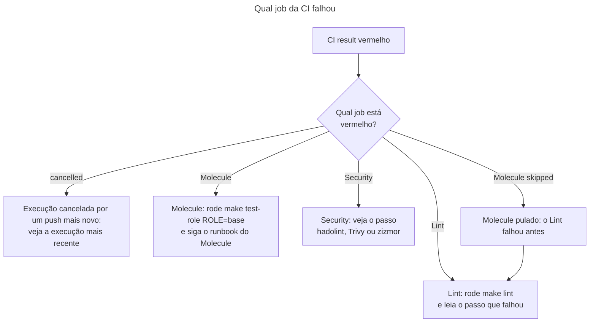

# Runbook: a CI falhou

> [!NOTE]
> Quando usar: o check `CI result` ficou vermelho em um pull request ou em um push para `main` ou `develop`. A mensagem do job é `A required job finished with result: <resultado>`, onde o resultado é `failure`, `cancelled` ou `skipped`.

O `CI result` só reúne o resultado de `Lint`, `Molecule` e `Security`. Quem falhou de verdade é um deles: abra o job vermelho, não o `CI result`. Definição da CI: [Pipeline de CI](../pipelines/ci.md).

Atenção: hoje a CI vermelha não bloqueia o merge, porque o ruleset da branch não exige o `CI result`. Quem revisa deve conferir o `CI result` antes de mesclar.

## Antes de começar
- Acessos necessários: leitura do repositório (ele é público) para ver o log. Para refazer jobs, permissão de escrita.
- Impacto esperado: nenhum. Refazer um job não altera o repositório.

## Diagnóstico
Comece pelo job que falhou e pelo passo vermelho dentro dele.

1. Abra a execução e identifique o job vermelho. Se `Molecule` aparece como pulado, o `Lint` falhou antes (o `Molecule` depende dele): comece pelo `Lint`.
2. Se o resultado foi `cancelled`, confira se existe uma execução mais nova do mesmo pull request. Um novo push cancela a anterior, e o `CI result` da cancelada reprova. Vale a mais recente.
3. Abra o passo vermelho e leia a mensagem. A tabela abaixo diz o que cada passo confere e como reproduzir.

| Job | Passo vermelho | O que significa | Como reproduzir e corrigir |
| --- | --- | --- | --- |
| `Lint` | Lint the workflows (actionlint) | Erro de sintaxe ou de expressão em um workflow | Leia a linha apontada no log e corrija o `ci.yml`. O actionlint não roda no `make lint` |
| `Lint` | Install the toolchain and the collections | O `make setup` falhou: `uv.lock` ou `requirements.yml` com problema, ou uma coleção indisponível | Rode `make setup` na sua máquina e leia o erro |
| `Lint` | Run yamllint, ansible-lint and the Vault check | Estilo de YAML, regra do `ansible-lint` (perfil `production`) ou `vault.yml` em texto puro | Rode `make lint`. Para o Vault, veja o [runbook do Vault](vault.md) |
| `Molecule` | Run the Molecule scenarios | Um cenário falhou no `create`, `converge`, `idempotence` ou `verify` | Rode `make test-role ROLE=base` e siga o [runbook do Molecule](molecule.md) |
| `Security` | Lint the test image Dockerfile (hadolint) | O `tests/images/ubuntu/Dockerfile` desrespeita uma regra do hadolint | Corrija o Dockerfile conforme a regra citada no log |
| `Security` | Scan the configuration files (Trivy) | O Trivy achou um problema de configuração (`--exit-code 1`: qualquer achado reprova) | Corrija o arquivo apontado. Só aceite uma exceção no `.trivyignore` com comentário que explique o motivo, como as de DS-0002 e DS-0026, e lembre que a exceção vale para o repositório inteiro ([ADR-0001](../decisoes/0001-imagem-oficial-do-trivy.md)) |
| `Security` | Audit the workflows (zizmor) | O zizmor achou um problema de segurança em um workflow | Rode `uvx zizmor@1.32.0 --offline .` na raiz do repositório e corrija o que ele apontar |

4. Se o passo demorou muito e foi cortado, lembre os limites do `ci.yml`: `Lint` e `Security` têm 10 minutos, `Molecule` 30 e `CI result` 5.
5. Se a falha parece passageira (rede, indisponibilidade de um registro), use "Re-run failed jobs" na página da execução. Se falhar de novo do mesmo jeito, trate como falha real.
6. Se a falha começou depois de uma atualização de versão, reverta a linha da versão e siga o [runbook de atualização](atualizar-versoes-fixadas.md).
7. Se o passo de cache das coleções parece servir uma versão antiga, lembre que a chave do cache é o hash do `requirements.yml` (`ci.yml`, linhas 49 a 53): uma mudança nesse arquivo gera um cache novo.

## Correção
1. Corrija a causa na sua branch, usando o comando de reprodução da tabela.
2. Faça o commit e o push. A CI roda de novo sozinha; o push cancela a execução anterior do pull request.

## Verificação
- `Lint`, `Molecule` e `Security` ficam verdes e o `CI result` imprime `Every job succeeded.`
- Para um push direto em `main` ou `develop`, a execução do commit mais novo fica verde.

## Se não resolver
Abra uma issue no repositório `FWesleycosta/ansible-playbooks` com o link da execução que falhou, o nome do job e do passo e o trecho do log com o erro, e avise o responsável do repositório.

## Pendências e risco conhecido
- Hoje a CI vermelha não bloqueia o merge: o ruleset `protege-main-develop` não exige o check `CI result` (verificado em 10/11/2026 na configuração de rulesets do repositório no GitHub, que não está no código). Quem revisa deve conferir o `CI result` antes de mesclar.
