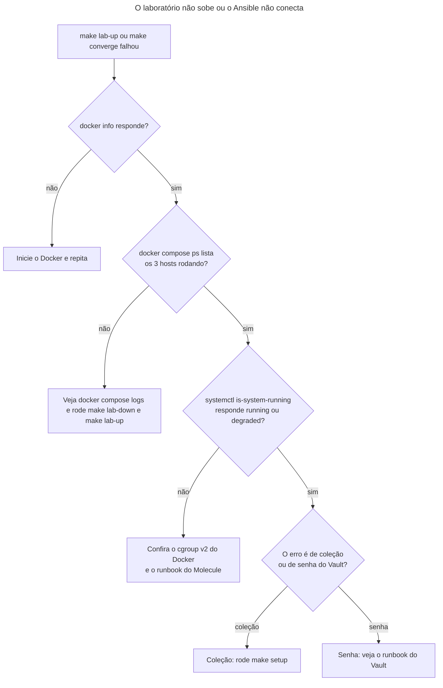

# Runbook: subir, usar e remover o laboratório local

> [!NOTE]
> Quando usar: você quer aplicar os playbooks nos hosts de teste (`make converge`), ver o que mudaria (`make check`) ou limpar o ambiente (`make lab-down`). Também serve quando o laboratório não sobe ou o Ansible não alcança os hosts.

O laboratório são três contêineres Ubuntu com systemd (`web-01`, `web-02` e `db-01`) em `lab/compose.yml`. O Ansible os alcança pela conexão `community.docker.docker`, sem SSH nem IP (`inventories/lab/hosts.yml`). É o alvo padrão do `ansible.cfg`: nenhum comando deste runbook toca um host real. A decisão está no [ADR-0004](../decisoes/0004-laboratorio-conteineres-systemd.md).

## Antes de começar
- Acessos necessários: nenhum acesso externo. Você precisa de:
  - Docker em execução, com cgroup v2. O mantenedor testou com Docker 29.9.2, cgroup v2 e o driver de armazenamento containerd. Este runbook não promete versão mínima.
  - `uv`, `make` e o ambiente preparado com `make setup` (instala as ferramentas do `uv.lock` e as coleções do `requirements.yml`).
  - A senha do Vault do laboratório, para `make check` e `make converge`. Se você não a tem, siga o [runbook do Vault](vault.md).
- Impacto esperado: só cria e remove contêineres locais, com nomes `lab-web-01`, `lab-web-02` e `lab-db-01`. Os contêineres rodam com `privileged: true` e o cgroup do host (`lab/compose.yml`): use só na sua máquina.

## Diagnóstico
O fluxo abaixo ajuda quando o laboratório não sobe ou o `make converge` não conecta. Siga as perguntas de cima para baixo.



1. Confira se o Docker responde.
   ```bash
   docker info
   ```
   Resultado esperado: informações do servidor, sem erro de conexão.
2. Confira os contêineres do laboratório.
   ```bash
   docker compose --file lab/compose.yml ps
   ```
   Resultado esperado: `web-01`, `web-02` e `db-01` em execução.
3. Confira o systemd dentro de um host.
   ```bash
   docker exec lab-web-01 systemctl is-system-running
   ```
   Resultado aceito: `running` ou `degraded`. Em contêiner, `degraded` é comum: o `.trivyignore` explica que o healthcheck foi dispensado por isso.

## Correção
Siga o procedimento normal; os passos 1 a 4 também recriam um laboratório que travou.

1. Suba o laboratório.
   ```bash
   make lab-up
   ```
   Executa `docker compose --file lab/compose.yml up --detach --wait`. Cria os contêineres e espera que fiquem em execução. Altera: cria contêineres locais. Se a imagem `localhost/ansible-playbooks/test-ubuntu:24.04` não existir, rode `make image` antes (o Compose também a constrói a partir de `tests/images/ubuntu`).
2. Veja o que mudaria, sem aplicar.
   ```bash
   make check
   ```
   Executa `ansible-playbook playbooks/site.yml --check --diff` e pede a senha do Vault. Se `ANSIBLE_VAULT_PASSWORD_FILE` apontar para um arquivo fora do repositório, não pergunta. Não altera os hosts.
3. Aplique a baseline.
   ```bash
   make converge
   ```
   Executa `ansible-playbook playbooks/site.yml --diff`. Altera: configura os pacotes, o fuso e o MOTD dos três hosts. Para outro playbook, use `make converge PLAYBOOK=playbooks/base.yml`.
4. Remova o laboratório quando terminar.
   ```bash
   make lab-down
   ```
   Executa `docker compose --file lab/compose.yml down`. Altera: remove os contêineres do laboratório.

## Verificação
- Depois do `make converge`, rode o comando de novo: a segunda execução não deve mostrar mudanças (`changed=0` no resumo). O Molecule prova isso para a role `base` ([runbook do Molecule](molecule.md)); no laboratório você confere à mão.
- Confira o resultado em um host: `docker exec lab-web-01 cat /etc/motd` mostra a mensagem do grupo `web` (`inventories/lab/group_vars/web.yml`) e `docker exec lab-db-01 cat /etc/motd` mostra a mensagem padrão da role.
- Depois do `make lab-down`, `docker compose --file lab/compose.yml ps` não lista nenhum host.

## Se não resolver
Abra uma issue no repositório `FWesleycosta/ansible-playbooks`, com a saída completa do comando que falhou, o resultado de `docker info` e o sistema operacional que você usa, e avise o responsável do repositório.

## Pendências
Nenhuma.
