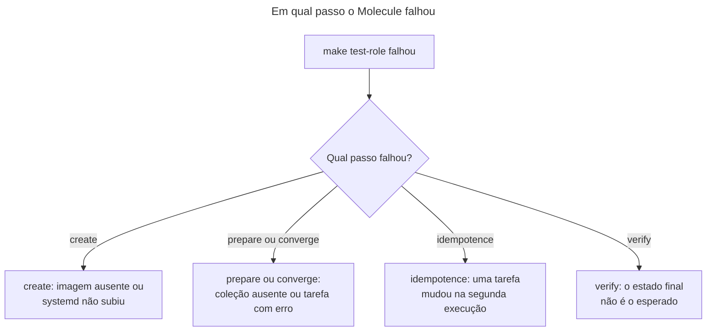

# Runbook: rodar os testes do Molecule e resolver falhas

> [!NOTE]
> Quando usar: você quer testar uma role (`make test-role ROLE=base`) ou todas (`make test`), ou o job `Molecule` da CI falhou e você precisa reproduzir o erro na sua máquina.

O Molecule aplica a role em dois contêineres com systemd (Ubuntu 24.04 e 26.04), aplica de novo para provar que não há mudança (idempotência) e confere o estado final. O desenho e as decisões estão no [ADR-0007](../decisoes/0007-molecule-ubuntu-2404-2604-idempotencia.md) e no [ADR-0004](../decisoes/0004-laboratorio-conteineres-systemd.md).

## Antes de começar
- Acessos necessários: Docker em execução, com cgroup v2 (o mantenedor testou com Docker 29.9.2, cgroup v2 e driver de armazenamento containerd; não há versão mínima prometida), `uv`, `make` e o ambiente de `make setup`. O teste não usa o Vault. A construção das imagens e a instalação de pacotes nos contêineres precisam de acesso à internet.
- Impacto esperado: constrói duas imagens locais (`localhost/ansible-playbooks/test-ubuntu:24.04` e `:26.04`) e cria e remove dois contêineres (`base-ubuntu-2404` e `base-ubuntu-2604`). Nenhum host real é tocado.

## Diagnóstico
Os passos de um cenário, na ordem, são: `destroy`, `create`, `prepare`, `converge`, `idempotence`, `verify` e `destroy`. O passo que falhou diz onde procurar.



1. Rode o cenário e anote o passo em que ele parou (o Molecule imprime o nome do passo).
   ```bash
   make test-role ROLE=base
   ```
   `test-role` depende de `image`: constrói as duas imagens antes e depois chama `molecule test --scenario-name base`. Resultado esperado: todos os passos em verde e, no fim, o `destroy`. Altera: cria e remove contêineres e imagens locais.
2. Para depurar sem destruir os contêineres, rode só até o passo que interessa (comandos padrão do Molecule, a conferir na primeira execução).
   ```bash
   uv run --frozen molecule converge --scenario-name base
   uv run --frozen molecule login --scenario-name base --host base-ubuntu-2404
   ```
   O primeiro cria os contêineres e aplica a role; o segundo abre um shell no host. Ao terminar, remova tudo com `uv run --frozen molecule destroy --scenario-name base`.

## Correção
**Falha no `create`: imagem ausente ou systemd não subiu.**
1. Construa as imagens.
   ```bash
   make image
   ```
   Constrói `test-ubuntu:24.04` e `test-ubuntu:26.04` a partir de `tests/images/ubuntu/Dockerfile`; a 26.04 recebe o digest do `Makefile` (`UBUNTU_2604_BASE`) pelo argumento `BASE_IMAGE`.
2. Confirme que o Docker usa cgroup v2.
   ```bash
   docker info --format '{{.CgroupVersion}}'
   ```
   Resultado esperado: `2`.
3. Lembre o que o systemd exige. Cada plataforma de `molecule/base/molecule.yml` usa `privileged: true`, `cgroupns_mode: host`, `tmpfs` em `/run`, `/run/lock` e `/tmp`, o volume `/sys/fs/cgroup` e `override_command: false`, para que o `CMD` da imagem (o systemd) rode como PID 1. Se você mudou algum desses campos, desfaça e teste de novo.

**Falha no `prepare` ou no `converge`: coleção ausente.**
1. Instale as coleções fixadas.
   ```bash
   make setup
   ```
   O passo `dependency` do Molecule está desabilitado (`molecule.yml`, linhas 14 a 20); o `requirements.yml` é a única fonte de `community.docker` e `ansible.posix`, necessárias ao driver Docker. Uma coleção que só existe no seu `~/.ansible` não vale: na CI ela faltaria.

**Falha no `converge`: o `apt` não acha um pacote (por exemplo, `curl`).**
1. Isso acontece quando o host não tem listas de pacotes e o `apt` pula a atualização do cache. A role resolve com `tasks/install.yml` (procura `/var/lib/apt/lists/*_Packages*` e força a atualização quando não acha) e o `molecule/base/prepare.yml` reproduz esse estado de propósito (listas vazias com data recente). Se o erro voltar, confira se esses dois arquivos continuam como estão (histórico no commit `b109523`).

**Falha no `idempotence`: uma tarefa mudou na segunda execução.**
1. Leia o log do passo `idempotence`: o Molecule lista as tarefas que reportaram `changed`.
2. Corrija a tarefa para ser idempotente: use um módulo com `state` em vez de `shell` ou `command`; se não houver módulo, defina `changed_when` (e `creates` ou `removes`, quando couber). Regra em `docs/standards.md`, seção "Writing tasks".

**Falha no `verify`: o estado final não é o esperado.**
1. Leia a asserção que falhou em `molecule/base/verify.yml` (pacotes, link `/etc/localtime`, `/etc/timezone` e `/etc/motd`). O `verify` confere o estado final do host, não as tarefas.
2. Reproduza com `molecule converge` e `molecule login` (passo 2 do diagnóstico) e compare o host com o esperado.

**Contêineres sobraram de uma execução interrompida.**
1. Remova-os.
   ```bash
   uv run --frozen molecule destroy --scenario-name base
   ```

## Verificação
- `make test-role ROLE=base` termina sem erro, com os passos `idempotence` e `verify` em verde nas duas plataformas.
- `docker ps --filter name=base-ubuntu` não lista contêineres depois do `destroy`.
- Para repetir o que a CI faz, rode `make test` (todos os cenários), que é o comando do job `Molecule`.

## Se não resolver
Abra uma issue no repositório `FWesleycosta/ansible-playbooks` com o log completo do passo que falhou, o resultado de `docker info` (versão e cgroup) e o sistema operacional, e avise o responsável do repositório. Se a falha for só na CI, inclua o link da execução.

## Pendências
Nenhuma.
