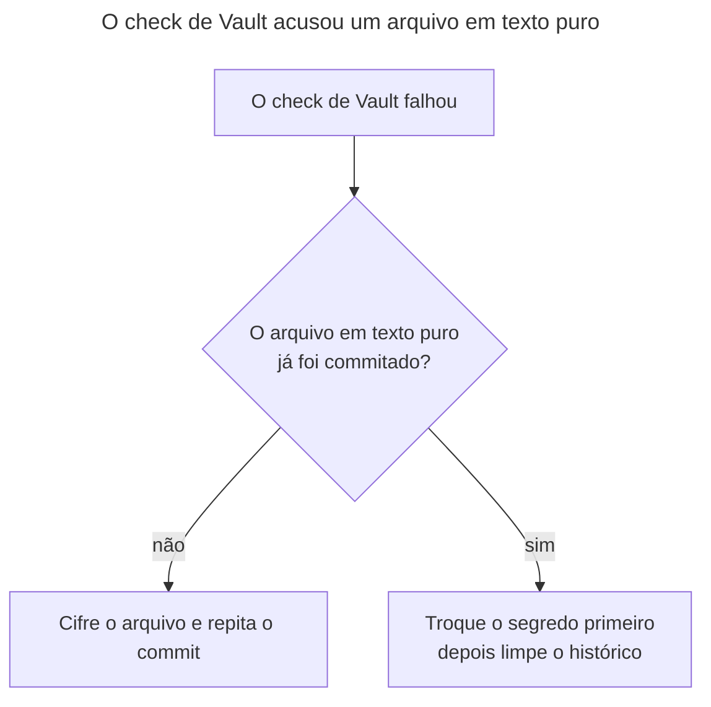

# Runbook: criar, editar e proteger arquivos do Ansible Vault

> [!NOTE]
> Quando usar: você precisa criar ou editar um `vault.yml`, obter acesso à senha do Vault do laboratório, trocar a senha, ou o hook `vault-encrypted` (ou o `make lint`) acusou um arquivo em texto puro.

O repositório guarda segredos em duas partes: `main.yml` tem a referência (`lab_demo_api_token: "{{ vault_lab_demo_api_token }}"`) e `vault.yml`, na mesma pasta, tem o valor cifrado. A senha nunca entra no repositório. A decisão está no [ADR-0003](../decisoes/0003-vault-em-duas-partes.md).

> [!WARNING]
> Nunca cole um valor sensível em issue, pull request, commit ou documentação. O Vault do laboratório guarda só um token de demonstração falso (`inventories/lab/group_vars/all/main.yml`, linhas 5 e 6), mas siga o mesmo cuidado de um segredo real.

## Antes de começar
- Acessos necessários:
  - Ambiente preparado com `make setup` (os comandos usam `uv run --frozen`, que roda o `ansible-vault` do `uv.lock`).
  - A senha do Vault. Quem chega ao repositório a obtém pedindo ao responsável do repositório, por um canal seguro fora do repositório. Este runbook não indica o canal.
- Impacto esperado: só altera os arquivos `vault.yml` que você indicar. Nada é enviado para fora da máquina.

## Diagnóstico
Use o fluxo quando o `make lint` ou o hook `vault-encrypted` falhar. A mensagem do script é `ERROR: <arquivo> is not encrypted. Run: uv run ansible-vault encrypt <arquivo>`.



1. Veja quais arquivos estão em texto puro.
   ```bash
   scripts/check-vault-encrypted.sh
   ```
   Resultado esperado quando está tudo certo: `Vault files encrypted: N`. Sem arquivos do Vault, imprime `No Vault files found.` Não altera nada. O script olha só se a primeira linha começa com `$ANSIBLE_VAULT;`.
2. Verifique se o arquivo já entrou no histórico do Git: `git log --oneline -- <caminho do vault.yml>`. Se algum commit já o contém em texto puro, vá direto para "Se o texto puro já foi commitado".

## Correção
**Criar um vault novo** (por exemplo, para um grupo novo):
1. Crie o arquivo na pasta do grupo, já cifrado.
   ```bash
   uv run --frozen ansible-vault create inventories/lab/group_vars/<grupo>/vault.yml
   ```
   Pede a senha duas vezes e abre o editor. Declare as variáveis com o prefixo `vault_`. Altera: cria o arquivo.
2. Declare a referência no `main.yml` da mesma pasta: `<variavel>: "{{ vault_<variavel> }}"`.

**Editar um vault existente:**
1. Abra o arquivo no editor, decifrado só durante a edição.
   ```bash
   uv run --frozen ansible-vault edit inventories/lab/group_vars/all/vault.yml
   ```
   Pede a senha, a menos que `ANSIBLE_VAULT_PASSWORD_FILE` aponte para um arquivo com ela. Altera: regrava o arquivo cifrado.

**Usar um arquivo de senha em vez do prompt:**
1. Guarde a senha num arquivo **fora do repositório** (por exemplo, na sua pasta pessoal) e aponte a variável para ele.
   ```bash
   export ANSIBLE_VAULT_PASSWORD_FILE=<caminho do arquivo fora do repositório>
   ```
   O `make converge` e o `make check` deixam de pedir a senha (`Makefile`, linhas 13 e 14). O `.gitignore` bloqueia nomes como `.vault-pass*`, `*vault-password*` e `*vault_pass*` dentro do repositório, como segunda proteção.

**Cifrar um arquivo que ficou em texto puro (ainda não commitado):**
1. Cifre o arquivo.
   ```bash
   uv run --frozen ansible-vault encrypt inventories/lab/group_vars/<grupo>/vault.yml
   ```
   Altera: cifra o arquivo no lugar. Rode `scripts/check-vault-encrypted.sh` em seguida.

**Trocar a senha do Vault.** Faça isso só se houver suspeita de vazamento da senha. Não há troca periódica: o cofre do laboratório guarda apenas um token de demonstração falso.
1. Troque a senha de cada `vault.yml`.
   ```bash
   uv run --frozen ansible-vault rekey inventories/lab/group_vars/all/vault.yml
   ```
   Pede a senha antiga e a nova. Altera: regrava o arquivo com a nova senha. Combine a nova senha com o responsável do repositório, pelo canal seguro, e avise quem usa o laboratório.

**Se o texto puro já foi commitado ou enviado:**
1. Troque o segredo primeiro: gere um valor novo e atualize o `vault.yml` cifrado. Limpar o histórico não desfaz o vazamento (`docs/standards.md`, seção "Secrets": "A secret that reaches Git history is rotated first; cleaning the history comes after").
2. Avise o responsável do repositório. A limpeza do histórico é uma tarefa separada, com revisão.

## Verificação
- `scripts/check-vault-encrypted.sh` termina com `Vault files encrypted: N` e código de saída 0.
- `make lint` passa (ele chama o mesmo script).
- `head -n 1 inventories/lab/group_vars/all/vault.yml` mostra uma linha que começa com `$ANSIBLE_VAULT;`. Não mostre nem copie o resto do arquivo.
- O hook funciona: no próximo `git commit` que incluir um `vault.yml`, o hook `vault-encrypted` roda sobre os arquivos que casam com `(^|/)vault\.ya?ml$`. Instale os hooks com `make hooks` se ainda não o fez.

## Se não resolver
Abra uma issue no repositório `FWesleycosta/ansible-playbooks` descrevendo o erro e o comando usado, sem colar nenhum valor do Vault nem a senha, e avise o responsável do repositório.

## Pendências
Nenhuma.
